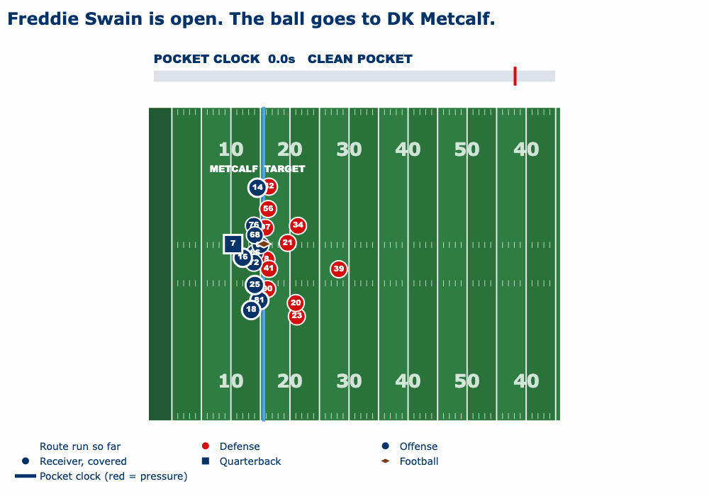
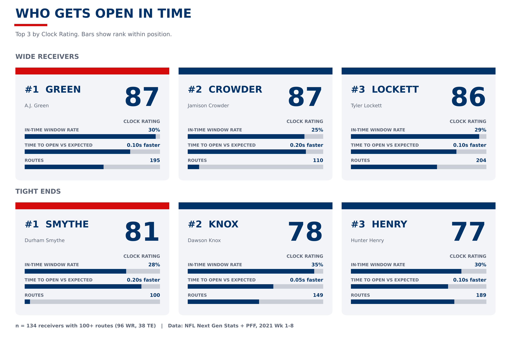

# Open, In Time: Was the Open Receiver a Real Chance?

**A tracking-based look at when receivers get open, whether it was in time to be thrown to, and who does it best.**

**Live site:** https://nfl-hack.github.io/backend/

  

  

## Metrics we generate

1. **Pocket Clock vs Open Clock:** on every pass play we measure time to pressure (when a rusher gets within 2 yards of the QB) against time to open (when each receiver gets 3+ yards from the nearest defender).
2. **Window Check:** for every clearly open receiver the QB passed up, we label the play **Open Window** (a real missed chance), **Too Late** (he got open after pressure, or under 0.4s before the throw) or **Not a Real Window** (out of the QB's view, or no longer open at the throw). On 2,229 plays with a receiver clearly open 5+ yards downfield¹, QBs threw elsewhere 72% of the time, but only **29%** of those were real Open Windows. Ignoring the open man costs about **8 yards** a play on average (14.7 vs 6.7; 79% vs 65% completions).
3. **Clock Rating (0-100):** ranks WRs and TEs on getting open in time and in the QB's view, compared within position. A.J. Green, Jamison Crowder and Tyler Lockett lead.

## Who it helps and how

- **Coaches:** if the pocket breaks before receivers get open, the team has a timing mismatch. Fix protection, or call quicker routes for receivers who open fast. The Window Check also shows whether a missed throw was "no time" or "didn't see him".
- **Scouts:** find receivers who get open before the pocket breaks down, not just eventually.
- **Broadcasters:** a live pocket clock with receivers lighting up as they get open.

**Method, full results, limitations and how to run it:** [METHOD.md](METHOD.md)

¹ Data: NFL Next Gen Stats + PFF, 2021 Weeks 1-8. 7 plays dropped (no snap event). The earlier openness analysis in `analysis/` counts 2,236 plays and 621 targets because it keeps them.
