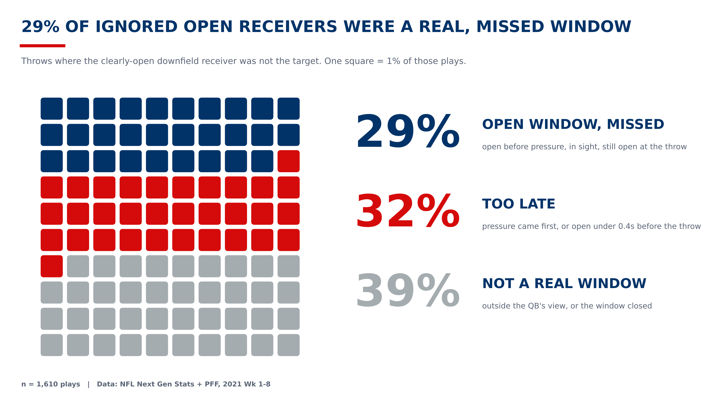

# Open, In Time: Was the Open Receiver a Real Chance?

**Open in Time:** A tracking-based ranking of receivers who get open early enough to be thrown to.

**Live site:** https://nfl-hack.github.io/backend/

  

  
  

**What we built:** Using 2021 NFL tracking data (weeks 1-8), we tracked when every receiver got open (3+ yards from the nearest defender), when pressure reached the QB, and whether the QB could see him.

**The insight:** On 2,229 plays, one receiver was clearly open 5+ yards downfield.¹ QBs threw elsewhere on 72% of them (1,610 plays), but only 29% of those were real missed chances. The rest came too late (32%: pressure arrived first, or he got open less than 0.4s before the throw) or were not a real window (39%: out of the QB's sight, or no longer open at the throw).

**Why it matters:** When the QB threw to the open receiver, the play gained 14.7 yards and was completed 79% of the time. When he didn't, it gained 6.7 yards and was completed 65% of the time.

**Who it helps:** Coaches can find the real missed throws on film. Scouts can find receivers who get open in time, using our 0-100 Clock Rating. Broadcasters can show viewers why the ball went elsewhere.

¹ 7 plays dropped: no snap event. The earlier openness analysis in `analysis/` counts 2,236 plays and 621 targets, because it keeps them.

**Method, full results, limitations and how to run it:** [METHOD.md](METHOD.md)
